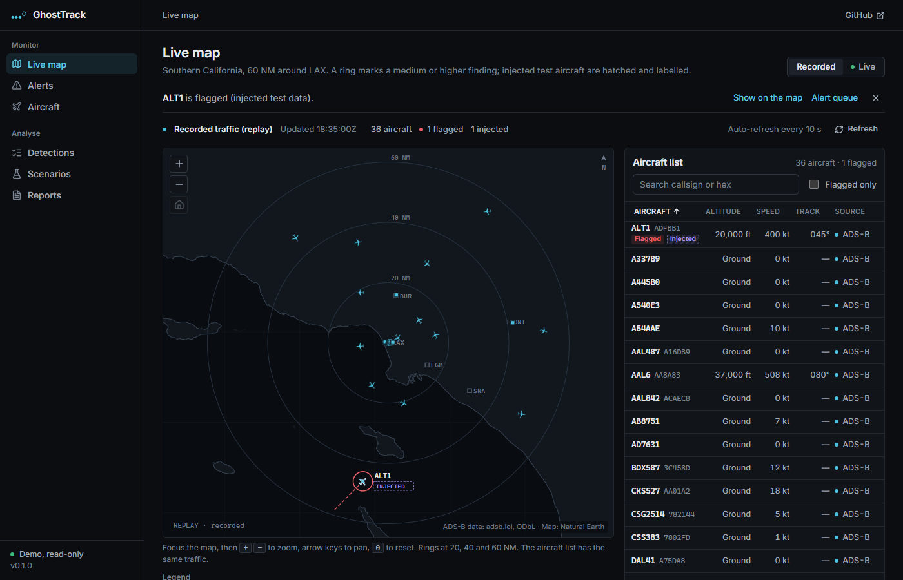
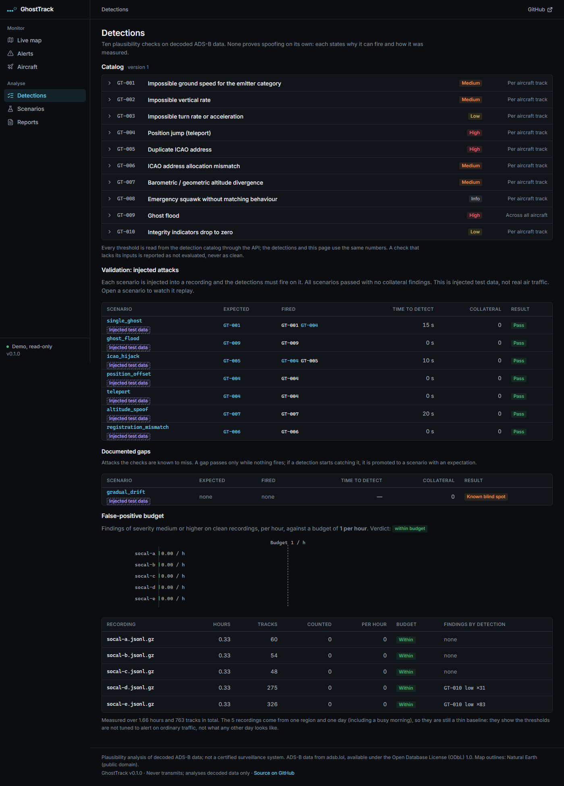
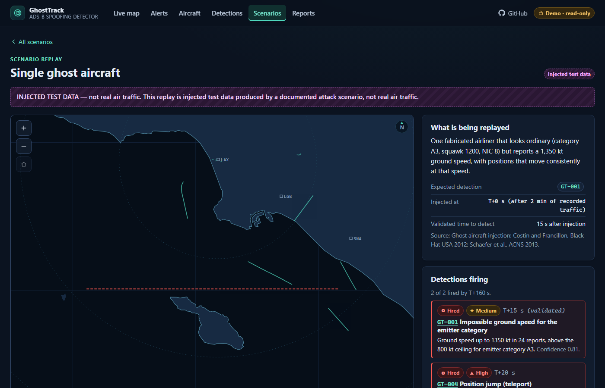
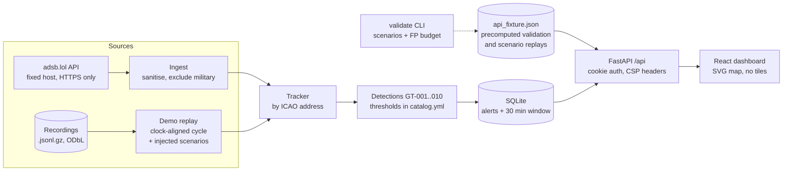

# GhostTrack

**An ADS-B plausibility detector.** GhostTrack watches decoded public air traffic within 60 NM of Los Angeles (LAX) and runs ten physical and consistency checks on every aircraft: speeds no airliner can fly, positions that teleport, one address in two places, an address that belongs to the wrong country, a sudden flood of aircraft. It is validated against seven injected attack scenarios, measured for false positives on real recordings, and honest about the one attack it cannot see.

> **GhostTrack is a portfolio project, not a certified surveillance system.** It does not replace air traffic control, a multilateration network or any safety-of-flight tool. Everything it flags has benign explanations that the UI lists next to the finding.

**Live demo: <https://ghosttrack.vercel.app/>** (placeholder: the deployment is done separately by the owner, so this link may not resolve yet). The hosted demo is read-only for visitors and replays recorded traffic with injected test scenarios.



## What GhostTrack does and doesn't do

**Does:**

- Reads **decoded** ADS-B data that volunteer receivers already aggregate (adsb.lol), for civil traffic only.
- Tracks every aircraft by its 24-bit ICAO address and applies **plausibility checks**: kinematics (speed, climb rate, turn rate, position jumps), identity (duplicate address, address versus registration), consistency (barometric versus geometric altitude, integrity indicators) and fleet behaviour (a flood of new aircraft).
- Explains every finding with the evidence, the threshold it crossed and the **benign causes** that could produce the same picture.
- Proves itself on **injected test data**: seven documented scenarios are replayed into recorded traffic, and everything injected is labelled "Injected test data" wherever it appears.

**Does not:**

- **No RF.** There is no radio, no SDR and no antenna code. It never receives or demodulates a signal itself.
- **No transmitting.** It cannot generate, inject or replay anything on the air. Scenarios exist only as rows in a database.
- **No certainty.** The checks are plausibility checks on data that arrives already decoded. They cannot prove an attack, and a flag is a reason to look, not a verdict.
- Military aircraft are excluded (best effort, see [Limitations](#honest-limitations)).

## Why ADS-B spoofing matters

ADS-B Out is mandatory in much of US airspace: 14 CFR 91.225 requires it in Class A, B and C airspace, within 30 NM of the listed busiest airports up to 10,000 ft MSL, and in most Class E airspace at and above 10,000 ft ([14 CFR 91.225, Cornell LII](https://www.law.cornell.edu/cfr/text/14/91.225)). The broadcasts are unauthenticated: the survey literature describes ADS-B as having no built-in security measures, so a receiver cannot tell a genuine report from a fabricated one by the message alone.

Researchers have shown the consequences on bench and lab setups:

- Costin and Francillon (EURECOM) presented practical attacks on ADS-B devices at Black Hat USA 2012, from eavesdropping to message injection and replay. [Whitepaper](https://s3.eurecom.fr/docs/bh12us_costin.pdf); [talk listing](https://infocondb.org/con/black-hat/black-hat-usa-2012/ghost-is-in-the-airtraffic).
- Schäfer, Lenders and Martinovic, "Experimental Analysis of Attacks on Next Generation Air Traffic Communication", ACNS 2013 (Lecture Notes in Computer Science 7954, pp. 253-271, Springer): an experimental analysis of ADS-B attacks, concluding that safety-critical decisions should not rely on ADS-B alone. [DOI 10.1007/978-3-642-38980-1_16](https://doi.org/10.1007/978-3-642-38980-1_16); [publication record](https://cs.ox.ac.uk/publications/publication8023-abstract.html).
- Strohmeier, Lenders and Martinovic, "On the Security of the Automatic Dependent Surveillance-Broadcast Protocol", IEEE Communications Surveys & Tutorials 17(2), 2015, pp. 1066-1087: a survey of the reported attacks and the proposed countermeasures. [DOI 10.1109/COMST.2014.2365951](https://doi.org/10.1109/COMST.2014.2365951); [preprint on arXiv](https://arxiv.org/abs/1307.3664).

Those papers are the reason the seven scenarios exist (ghost injection, flooding, address impersonation, message modification). A single-receiver plausibility layer is the cheapest first filter; the literature also points to multilateration and receiver cross-checks, which GhostTrack does not have (see [Limitations](#honest-limitations)).

## The workflow

1. **Ingest.** The backend fetches civil aircraft inside 60 NM of LAX from adsb.lol (live mode), or replays three committed recordings (demo mode).
2. **Sanitise.** Every record is validated: bad addresses, out-of-range positions and duplicates are dropped and counted; military aircraft are excluded.
3. **Track.** Aircraft are tracked by ICAO address, using the true position time (not the poll time), so a late or repeated report cannot fake a jump.
4. **Detect.** GT-001 to GT-010 run over every track (GT-009 over the whole fleet). Thresholds live only in `backend/ghosttrack/detections/catalog.yml`.
5. **Triage.** Findings become alerts with severity, confidence, evidence and benign causes. The admin acknowledges or dismisses them and can export an evidence pack (JSON or standalone HTML) or a summary report.
6. **Validate.** `python -m ghosttrack validate` injects the scenarios into recorded traffic and measures detections, collateral findings and the false-positive rate. CI fails if a scenario is missed or the budget is exceeded.

## Detections

| ID | Detection | Severity | What it looks for |
|---|---|---|---|
| GT-001 | Impossible ground speed for the emitter category | medium | Speed above the ceiling for the declared aircraft category |
| GT-002 | Impossible vertical rate | medium | Reported or implied climb/descent rate beyond the limit |
| GT-003 | Impossible turn rate or acceleration | low | Lateral acceleration beyond a structural load-factor bound |
| GT-004 | Position jump (teleport) | high | Implied speed between fresh positions above the limit |
| GT-005 | Duplicate ICAO address | high | One address in two places at once, faster than Mach 3 apart |
| GT-006 | ICAO address allocation mismatch | medium | Address block's State differs from the registration's State, or a US N-number maps to a different address |
| GT-007 | Barometric / geometric altitude divergence | medium | Pressure and GNSS altitude disagree by more than weather and geoid explain |
| GT-008 | Emergency squawk without matching behaviour | info | 7500/7600/7700 with no change in behaviour (informational) |
| GT-009 | Ghost flood | high | Many new, similar aircraft appearing together in a small area |
| GT-010 | Integrity indicators drop to zero | low | NIC or NACp falling to 0 while the track stays smooth |

Rationale, false-positive notes, benign causes and references for each are in the catalog and on the Detections page.



## Scenario validation and the false-positive budget

Seven attack scenarios are injected into recorded traffic and one documented gap (`gradual_drift`) is expected **not** to fire. This is the real output of `python -m ghosttrack validate` (a test fails if this block drifts from the program's output):

<!-- validate:start -->
```text
Scenario validation (injected test data)

scenario                expected  fired                         result   time to detect
---------------------------------------------------------------------------------------
single_ghost            GT-001    GT-001,GT-004                 PASS               15 s
ghost_flood             GT-009    GT-009                        PASS                0 s
icao_hijack             GT-005    GT-004,GT-005                 PASS               10 s
position_offset         GT-004    GT-004                        PASS                0 s
teleport                GT-004    GT-004                        PASS                0 s
altitude_spoof          GT-007    GT-007                        PASS               20 s
registration_mismatch   GT-006    GT-006                        PASS                0 s

Documented gaps (expected NOT to fire: known blind spots)

scenario                fired                         result  
--------------------------------------------------------------
gradual_drift           none                          GAP HOLDS

Clean recordings: findings (budget counts severity >= medium: 1 per hour)

recording             hours  tracks  counted  per hour  findings by detection/severity
--------------------------------------------------------------------------------------
socal-a.jsonl.gz       0.33      60        0      0.00  none
socal-b.jsonl.gz       0.33      54        0      0.00  none
socal-c.jsonl.gz       0.33      48        0      0.00  none
```
<!-- validate:end -->

How to read it:

- **Time to detect** is measured at snapshot granularity (about 5-6 s in the recordings, 10 s live); 0 means detected on the first injected report.
- **`gradual_drift` is a known gap.** A real track dragged 0.1 NM per poll stays inside every kinematic limit, so single-receiver plausibility checks cannot see it. If a future change makes it fire, validation reports `GAP CLOSED` and fails until the scenario is promoted.
- **False-positive budget.** Only findings of severity medium or high count. The budget is the larger of 1.0 per hour and 1.5 times the measured rate, so with zero findings it sits at the 1.0/h floor.

**The baseline is thin.** The measurement comes from three contiguous 20-minute recordings taken overnight (00:39-01:39 Pacific, light traffic, 48-60 aircraft each), about one hour in total. A rate of 0 per hour on that data says little about busy daytime traffic. Two daytime recordings will be added and the numbers above will change; until then the 1.0/h budget is a placeholder floor, not an earned figure.



## Data sources and licences

- **Traffic:** [adsb.lol](https://adsb.lol) open data (`api.adsb.lol`), licensed under the [Open Database License (ODbL) 1.0](https://opendatacommons.org/licenses/odbl/1-0/). *Contains information from adsb.lol (https://adsb.lol), which is made available here under the Open Database License (ODbL) (https://opendatacommons.org/licenses/odbl/1-0/).* The notice is shown in the app footer, on the map and here. The committed recordings are a derived database and ship under the ODbL with `backend/data/LICENSE-ODbL.md`.
- **Basemap:** Natural Earth outlines (public domain), clipped and simplified into `src/assets/basemap-socal.json`. No external map tiles are loaded.
- **Reference facts:** the ICAO 24-bit address allocation (Annex 10 Vol. III, Table 9-1), nationality marks and ADS-B emitter categories are our own short tables with sources cited in `DECISIONS.md` and `THIRD_PARTY.md`.

adsb.lol publishes no numeric rate limit. GhostTrack makes at most one upstream request per region per 10 seconds per instance, to one fixed host, with a descriptive User-Agent. See `DECISIONS.md` for the open question on whether a hosted demo counts as "production" use.

## Quick start

Requirements: Python 3.12+, Node 20.19+ (or 22.12+).

```bash
# Backend (from the repo root)
python -m venv backend/.venv
backend/.venv/bin/pip install -r backend/requirements-dev.txt   # Windows: backend\.venv\Scripts\pip
cd backend
python -m ghosttrack validate            # the table above
python -m ghosttrack demo                # API on :8000: recorded replay, read-only guests

# Frontend (second terminal, repo root)
npm ci
npm run dev                              # dashboard on :5173, proxies /api to :8000
```

`python -m ghosttrack serve` runs the API for a self-hosted install (sign-in required, no guests, no upstream requests until you set `GHOSTTRACK_LIVE=true`). To create the admin login, run `python -m ghosttrack create-admin` and set the variables it prints. To re-record traffic: `python scripts/record.py --name socal-d --minutes 20`, then `python scripts/build_demo.py`.

### Configuration

Set as environment variables or in `backend/.env` (git-ignored). Names only; see [.env.example](.env.example). Real environment variables always win.

| Variable | Purpose |
|---|---|
| `GHOSTTRACK_ADMIN_USER` | Admin user name (default `admin`) |
| `GHOSTTRACK_ADMIN_PASSWORD_HASH` | PBKDF2 hash of the admin password. Admin login exists only when this is set |
| `GHOSTTRACK_SECRET_KEY` | Signs session cookies; long and random; rotating it signs everyone out |
| `GHOSTTRACK_SESSION_HOURS` | Session length |
| `GHOSTTRACK_COOKIE_SECURE` | Send the session cookie over HTTPS only (default on; `demo` turns it off locally) |
| `GHOSTTRACK_DEMO` | Hosted-demo mode: recorded replay, scheduled injected scenarios, read-only guests |
| `GHOSTTRACK_GUEST` | Anonymous read-only access (default: on in demo mode only) |
| `GHOSTTRACK_LIVE` | Allow `mode=live`, the adsb.lol view (default: on in demo mode only) |
| `GHOSTTRACK_LIVE_INTERVAL_S` | Seconds between upstream requests per region (floor 10) |
| `GHOSTTRACK_DB` | SQLite path |
| `GHOSTTRACK_MAX_UPLOAD_MB` | Upload cap (default 10; at most 4 in demo mode) |
| `GHOSTTRACK_TRUST_PROXY` | Use `X-Forwarded-For` for the client IP; only behind a proxy you control |
| `GHOSTTRACK_COMPUTE_FIXTURES` | Development only: compute the API fixture on the fly if the committed one is stale |

### Deploying to Vercel

The deployment is done by the owner; nothing in this repository deploys itself. `vercel.json` builds the Vite frontend and routes `/api/*` to `api/index.py`, a Python function that wraps the FastAPI app. The function bundles the package (including `catalog.yml`), `backend/data/**` (the recordings and the precomputed `api_fixture.json` and `demo_fixture.json`) and the basemap JSON.

- The demo data is precomputed offline by `scripts/build_demo.py`; the function only reads it and answers 503 if the fixture is missing or stale. Re-run the script and commit after any change to the recordings, the catalog or the detections (CI checks it).
- The database lives in `/tmp` and is seeded lazily per function instance, so each instance has its own copy. In demo mode an admin's changes (triage, uploads) are therefore visible to other visitors on that instance until it recycles; the UI says so beside the admin controls.
- Admin login exists only if the owner sets `GHOSTTRACK_ADMIN_PASSWORD_HASH` and `GHOSTTRACK_SECRET_KEY` in the Vercel project settings. Without them everyone is a read-only guest.
- Uploads are capped at 4 MB in demo mode and whenever the `VERCEL` variable is set, under Vercel Functions' 4.5 MB request body limit ([Vercel limits](https://vercel.com/docs/functions/limitations#request-body-size)). `/api/health` reports the effective cap, and the upload form checks size first and explains a platform-level refusal, which may not be the app's own JSON 413.

## Architecture



## Security

- **SSRF prevention.** The only outbound host is `api.adsb.lol`, a constant in the code and never taken from input. The request path is built from numbers only (latitude, longitude and radius from an allow-listed region table), the opener refuses every redirect and ignores proxy environment variables, HTTPS is enforced, bodies over 5 MB are refused, and the timeout is 3 s. There is no route that fetches a user-supplied URL.
- **Content Security Policy and headers.** `default-src 'self'; script-src 'self'; connect-src 'self'; frame-ancestors 'none'` and friends, on both the API and the static site. `X-Content-Type-Options: nosniff`, `X-Frame-Options: DENY`, strict referrer policy and `Cache-Control: no-store` (except the live route). Downloaded HTML is sandboxed with its own CSP. Because the CSP blocks CDN scripts, the Swagger UI and ReDoc pages are not served at all; the OpenAPI JSON is available to the admin at `/api/openapi.json`.
- **No external tiles or fonts.** The map is hand-drawn SVG from a bundled Natural Earth outline, so no third party sees what you look at, and the CSP allows no other origin.
- **Authentication.** PBKDF2-SHA256 (600,000 iterations) password hashing, a signed JWT with a pinned algorithm in an httpOnly, SameSite=Strict cookie that never appears in a response body, a per-IP login limiter, fail-closed when unconfigured. Guests exist only in demo mode and can never write.
- **Untrusted input.** Every filter is allow-listed or validated, SQL is parameterized, request bodies are capped (64 KiB, or the upload cap for recordings), uploads are size- and decompression-limited and labelled "Uploaded recording (unverified)", and the upstream clock is not trusted.
- **Supply chain.** CI runs `pip-audit`, `npm audit` (high) and gitleaks; Dependabot is enabled.

## Tests

Last full run: **530 backend tests** (pytest, 0 skipped, about 2.5 minutes) and **41 frontend tests** (`node --test`, pure logic: geometry, formatting, charts, replay), all passing; the production build succeeds. The backend suite covers the detections and their catalog thresholds, the scenarios, the tracker, ingest, the API and auth, uploads, the demo replay, the exports, the Vercel entry point and this README's validation block.

```bash
cd backend && python -m pytest -q -rs    # -rs names any skipped test
npm test
```

CI (`.github/workflows/ci.yml`) runs on every push and pull request: backend tests (`-rs`, so skipped tests are named), `validate` (scenarios and the FP budget), the recordings manifest check, `build_demo.py --check`, frontend tests and build, `pip-audit`, `npm audit --audit-level=high` and gitleaks.

## Honest limitations

- **Aggregated, decoded data only.** adsb.lol gives GhostTrack the aircraft as decoded and merged by volunteer receivers. GhostTrack never sees raw messages or which receiver heard what.
- **No raw timestamps for multilateration.** The strongest spoofing defence, comparing arrival times at several receivers, needs per-receiver timestamps that this data does not carry. GhostTrack cannot do it, and the MLAT positions it does see are themselves computed by the network.
- **MLAT and coverage gaps.** Aircraft without ADS-B Out, low-altitude traffic out of receiver range and areas with few receivers are thin or missing. MLAT and TIS-B positions get looser thresholds and lower confidence because they are less precise.
- **A consistent, slow attack is invisible.** `gradual_drift` (a track dragged inside every kinematic limit) is a documented gap, as above.
- **Benign causes are real.** GNSS interference, receiver or decoder errors, address re-use, database errors in registrations and unconverged GNSS height all trigger the same checks. That is why every finding lists benign causes and why severity is not the same as certainty.
- **Military exclusion is best effort.** The point endpoint did not deliver `dbFlags` in the live sample, so aircraft are dropped on the flag when present or on the US DoD address block `AE0000-AFFFFF`. Other military traffic may appear.
- **Thin false-positive baseline.** One hour of overnight data, as above. Two daytime recordings are planned.
- **Scenarios are synthetic.** They show the checks working on the attacks they were written for; they are not evidence about attacks in the wild.

## Licence

- **Code:** MIT, see [LICENSE](LICENSE).
- **Recordings and derived data:** ODbL 1.0, see `backend/data/LICENSE-ODbL.md`. Other third-party data keeps its own licence, listed in [THIRD_PARTY.md](THIRD_PARTY.md).
